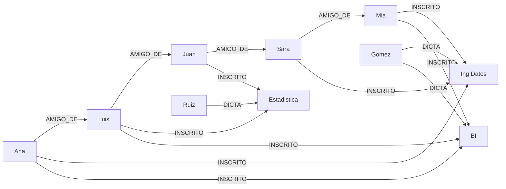

# Punto 4 - Amazon Neptune

Region: us-east-1

## Neptune vs Neo4j

**Neptune:** soporta grafos de propiedades y RDF. Usa openCypher, Gremlin (TinkerPop) y SPARQL 1.1. Como herramientas tiene Graph Explorer, graph-notebook y Neptune Workbench (Jupyter), el bulk loader para cargar desde S3, Neptune Analytics para algoritmos y Neptune ML.

**Neo4j:** solo grafo de propiedades etiquetado. Usa Cypher (el original, con APOC y conformidad GQL). Como herramientas tiene Neo4j Browser, Desktop, Bloom, la librería GDS, APOC y AuraDB (con capa gratuita).

Como usamos openCypher, las consultas que hicimos funcionarian casi igual en Neo4j.

## Aprovisionada vs Serverless

Aprovisionada: eliges una instancia y pagas una tarifa fija por hora mientras exista, la uses o no. Las T3/T4g funcionan en modo ilimitado: si tu uso promedio de CPU en 24 horas supera la línea base de la instancia, se cobran créditos de CPU a $0.15 por vCPU-hora.

Serverless: la capacidad se mide en Neptune Capacity Units (NCU), facturadas por segundo, y cada NCU tiene aproximadamente 2 GB de memoria. La capacidad mínima es 1 NCU, y antes era 2.5 NCU.

Elegimos aprovisionada con una db.t3.medium porque el taller tiene muy poca carga y se usa pocas horas, entonces una tarifa fija por hora es más fácil de calcular. Serverless no baja a cero (siempre cobra mínimo 1 NCU mientras el cluster exista) y puede subir de capacidad cuando se cargan datos, asi que no tenia mucho sentido para esto. Ademas la t3.medium entra en la prueba gratuita de Neptune.

Configuración usada: motor 1.4.8.0, db.t3.medium, sin réplicas, autenticación IAM activada. El almacenamiento quedó en I/O-Optimized; para tan pocas operaciones Standard hubiera sido más barato, pero la diferencia es de centavos.

## Conexión desde local

El túnel SSH necesita una instancia EC2 y una llave SSH, lo que añade el costo por hora de la EC2 y su disco EBS. Su configuración es más compleja, porque exige security groups para la EC2 y para Neptune, además de montar el túnel, pero Neptune se mantiene privado y no queda expuesto a internet. El endpoint público no requiere recursos adicionales ni genera costo extra, y su configuración es más sencilla. A cambio, Neptune queda accesible desde internet, aunque protegido por el security group, que solo permite la IP autorizada, y por la autenticación IAM obligatoria.

El EC2 no es necesario desde la versión 1.4.6 ya que Neptune permite endpoints públicos. Y otras alternativas son un endpoint público, una VPN o trabajar desde la VPC.

Nosotros usamos el endpoint público. Lo que quedó configurado:

- VPC: la default (172.31.0.0/16).
- Rutas: 172.31.0.0/16 → local y 0.0.0.0/0 → internet gateway. La segunda es la que deja entrar desde internet.
- Security group: neptune-test-sg, solo permite TCP 8182 desde mi IP (/32).
- Autenticación: IAM con firma SigV4 usando el usuario user_cli. No hay usuario ni contraseña de base de datos, por eso no se creó ningún secreto en Secrets Manager.
- Se usó el endpoint Writer porque el script inserta datos. El Reader es para repartir lecturas entre réplicas y como no hay réplicas apunta a la misma instancia.

Política que se le agregó a user_cli:

```json
{
  "Version": "2012-10-17",
  "Statement": [{
    "Effect": "Allow",
    "Action": "neptune-db:*",
    "Resource": "arn:aws:neptune-db:us-east-1:<ID_CUENTA>:<CLUSTER_RESOURCE_ID>/*"
  }]
}
```

## Modelo del grafo

10 vértices: 5 estudiantes (Ana, Luis, Sara, Juan, Mia), 3 cursos (BI, Ing Datos, Estadistica) y 2 profesores (Gomez, Ruiz).

15 relaciones: 8 INSCRITO (estudiante → curso), 3 DICTA (profesor → curso) y 4 AMIGO_DE (estudiante → estudiante).



## Paso a paso

1. Crear un security group en la VPC default con una regla de entrada TCP 8182 desde tu IP (sacar la IPv4 real con `curl -4 https://ifconfig.me`).
2. Crear el cluster en Neptune: Neptune Database, versión 1.4.6 o mayor, plantilla Development and testing, instancia db.t3.medium, sin réplicas, VPC default, el security group anterior (quitar el default), acceso público activado, autenticación IAM activada y sin notebook.
3. Agregarle a user_cli la política de arriba con el Resource ID del cluster (está en la pestaña Configuration).
4. Configurar las credenciales de user_cli con `aws configure` en la región us-east-1.
5. Instalar boto3 actualizado: `pip install --upgrade boto3`.
6. Poner el endpoint Writer del cluster en una variable de entorno: `export NEPTUNE_ENDPOINT="https://<endpoint>:8182"`.
7. Correr `python neptune_grafo.py`. El script revisa el estado, borra el grafo si ya existía, inserta los vértices y relaciones, los cuenta y corre las 3 consultas.
8. Borrar todo (ver abajo).

## Consultas y resultados

1. Con quién comparte curso Ana:

```cypher
MATCH (:Estudiante {nombre:'Ana'})-[:INSCRITO]->(c:Curso)<-[:INSCRITO]-(otro:Estudiante)
RETURN otro.nombre AS companero, c.nombre AS curso
```

Resultado: Luis (BI), Mia (Ing Datos), Mia (BI) y Sara (Ing Datos). Mia sale dos veces porque comparte los dos cursos con Ana.

2. Qué profesores les dictan a los amigos de Luis:

```cypher
MATCH (:Estudiante {nombre:'Luis'})-[:AMIGO_DE]->(amigo)-[:INSCRITO]->(c)<-[:DICTA]-(p:Profesor)
RETURN amigo.nombre AS amigo, c.nombre AS curso, p.nombre AS profesor
```

Resultado: Juan, Estadistica, Ruiz.

3. A quién llega Ana por amistades de 2 a 3 saltos:

```cypher
MATCH (:Estudiante {nombre:'Ana'})-[:AMIGO_DE*2..3]->(x:Estudiante)
RETURN DISTINCT x.nombre AS alcanzable
```

Resultado: Juan (Ana → Luis → Juan) y Sara (Ana → Luis → Juan → Sara). Mia queda a 4 saltos entonces no sale.

## Problemas que tuvimos

- Al principio dejé el endpoint de ejemplo en el script y no resolvía. Se cambió por el Writer real.
- Daba timeout. El cluster tenía el security group default, que bloquea conexiones de afuera, y además la regla del SG había guardado la IP de iCloud Private Relay (172.225.x.x) en vez de mi IP real. Se cambió el SG del cluster y se puso la IPv4 real. Para encontrar el problema usamos `nslookup` (para ver que el endpoint era público) y `nc -vz` al puerto 8182.
- Daba AccessDenied. La política no estaba asignada a user_cli y en el Resource tenía el nombre de la política en vez del Resource ID del cluster. Después de corregirla tocó esperar unos minutos a que IAM la aplicara.

## Costos

El cómputo se cobra por cada hora que la instancia está encendida. El almacenamiento cuesta alrededor de $0.10 por GB-mes, más un cobro de I/O por millón de peticiones (con I/O-Optimized no se cobra el I/O pero el almacenamiento y la instancia son más caros). El método de conexión no añade una instancia EC2. Mientras el clúster exista, se cobra la instancia por hora aunque no reciba tráfico, el almacenamiento de los datos y los backups o snapshots que superen la cuota gratuita, incluso después de borrar el clúster si se guarda un snapshot final.

En nuestro caso la instancia la cubrió la prueba gratuita de Neptune y el grafo pesa unos KB, entonces el costo fue $0.

## Eliminación

1. Se borró la instancia y el cluster sin snapshot final.
2. Se revisó que no quedaran snapshots.
3. Se borró el security group neptune-test-sg.
4. Se quitó la política de user_cli y se borró la primera política que había quedado suelta.
5. Se revisó Billing para confirmar que no quedaran cobros.
